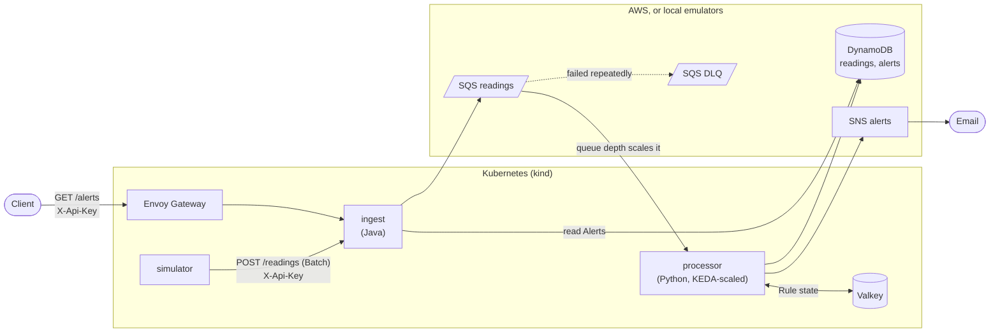

# Telemetry Monitor

[](https://github.com/Danie1Le/Telemetry-Monitor/actions/workflows/ci.yml?query=branch%3Amain)
[](LICENSE)

Telemetry Monitor is a small streaming pipeline. A simulated launch vehicle posts sensor Readings over HTTP. An ingest service validates them and queues them on SQS. A processor stores them in DynamoDB, runs anomaly Rules and records Alerts, which `GET /alerts` serves. It runs on Kubernetes (kind) with the queue, tables and topics emulated locally, and the same manifests can target real AWS. It demonstrates a Java and Python service pair behind JSON-schema contracts, queue-depth autoscaling with KEDA, at-least-once processing made safe by idempotent writes and a reorder buffer, and load, detection-time and chaos measurements.

CLAUDE.md and docs/agents/ configure the AI coding agents used to build the project.

Terms (Reading, Batch, Flight, Phase, Fault, Alert...) are defined in [GLOSSARY.md](GLOSSARY.md). Design decisions: [docs/adr/](docs/adr/).



## Results

Measured on a local kind cluster, and once with real AWS queues and tables (last bullet). [RESULTS.md](RESULTS.md) has the hardware, commands and raw output.

- [1,500 readings/s sustained for 10 minutes](RESULTS.md#throughput), with a [9.13 ms p95 ingest latency](RESULTS.md#p95).
- [Ramp: no failures up to 2,000 readings/s](RESULTS.md#ramp), in 2-minute steps (a 10-minute run at that rate failed: see the [attempts](RESULTS.md#sustained-attempts)).
- KEDA adds a processor replica [21.6 s and 102.3 s after the queue passes its target](RESULTS.md#scale-up) (in the second ramp the queue briefly crossed and fell back; 22.7 s from its next crossing) and [drains back to one in 44.6 s and 56.9 s](RESULTS.md#scale-down) (two ramps).
- Alerts appear in `GET /alerts` [2.3 s (dropout)](RESULTS.md#detect-dropout), [5.4 s (stuck)](RESULTS.md#detect-stuck) and [11.5 s (drift)](RESULTS.md#detect-drift) after the fault starts (median of 10 runs, understated by up to about 1 s: [see the note](RESULTS.md#appeared)).
- [No lost or extra readings or alerts](RESULTS.md#chaos) with 29 processor pods force-deleted during a 5-minute load.
- [100% statement coverage of the anomaly rules](RESULTS.md#coverage-rules), and [99% of processor statements and 97% of ingest instructions](RESULTS.md#coverage).
- [On AWS](RESULTS.md#aws-throughput) (real SQS, DynamoDB and SNS; services on kind), 150 readings/s (3 batches/s, under the 20 WCU table's 200 readings/s limit) were accepted with no failures and no throttling, but the queue was not flat: [see the note](RESULTS.md#aws-note).

## Layout

| Path | What |
|---|---|
| `simulator/` | Python. Flies Flights, injects Faults from `scenarios/` or `POST /faults` |
| `ingest/` | Java (Spring Boot). Validates Batches, drops Corrupt readings, queues to SQS, serves `GET /alerts` |
| `processor/` | Python. Stores Readings, runs the Rules, records Alerts, publishes to SNS |
| `contracts/`, `sensors.yaml`, `scenarios/` | Shared config and JSON schemas, no shared code |
| `k8s/` | Base manifests, `local` (emulators) and `aws` overlays |
| `terraform/` | `bootstrap` (budgets) and `main` (queues, tables, topics, demo IAM user) |
| `load/`, `scripts/` | k6 scripts and the scripts below |
| `docs/adr/`, `docs/runbook.md` | Decisions and the one-time AWS deploy |

## Prerequisites

Docker, `kind`, `kubectl`, [uv](https://docs.astral.sh/uv/) (Python 3.14), and a JDK (the Gradle wrapper provisions Java 25). Terraform and the AWS CLI only for the AWS runbook.

## Local loop (kind)

```bash
scripts/kind-up.sh                                      # cluster, images, emulators; ingest at http://localhost:8080
uv run --project simulator scripts/e2e.py [scenario ...]  # fly each Scenario (or those named), assert its Alerts
uv run --project simulator scripts/measure.py <command>   # scale, sustained, detection, chaos; see its docstring
scripts/kind-down.sh
```

`GET /alerts` reads a Flight's Alerts. It and `POST /readings` need the `X-Api-Key` header, whose value `scripts/kind-up.sh` generates into the Secret `ingest-api-key`. Only `/actuator/health` (and its `liveness` and `readiness` groups) is open; every other Actuator endpoint is unexposed. `curl -H @-` reads the header from stdin, which keeps the key off the command line. Flight ids are in `kubectl --context kind-telemetry -n telemetry logs deploy/simulator`.

```bash
key=$(kubectl --context kind-telemetry -n telemetry get secret ingest-api-key -o jsonpath='{.data.key}' | base64 -d)
curl -H @- "http://localhost:8080/alerts?flightId=<id>" <<<"X-Api-Key: $key"
```

## Run one service on the host

`docker compose up -d` starts only the emulators: ElasticMQ (SQS, 9324), DynamoDB Local (8000), moto (SNS, 5000), Valkey (6379), and an `init` container that creates the `readings` and `alerts` tables and the `alerts` topic. Ingest's defaults already point at them:

```bash
docker compose up -d
export INGEST_API_KEY=$(od -An -tx1 -N16 /dev/urandom | tr -d ' \n')   # ingest will not start without one
(cd ingest && ./gradlew bootRun)               # :8080
uv run --project simulator python -m simulator # posts to http://localhost:8080/readings
```

## Tests

```bash
cd simulator && uv run pytest
cd processor && uv run pytest -m "not integration"
cd processor && uv run pytest -m integration              # Testcontainers: needs Docker, not docker compose
cd ingest && ./gradlew spotlessCheck test
cd ingest && ./gradlew integrationTest
```

## CI

`.github/workflows/ci.yml`: on every push, ruff, pytest with coverage gates (simulator, processor), Gradle checks (ingest) and terraform fmt/validate/tflint. On pull requests only: Testcontainers integration tests (processor), `integrationTest` (ingest), image builds and the `kind` e2e run.

## More

- [RESULTS.md](RESULTS.md): measured numbers, each with how it was measured
